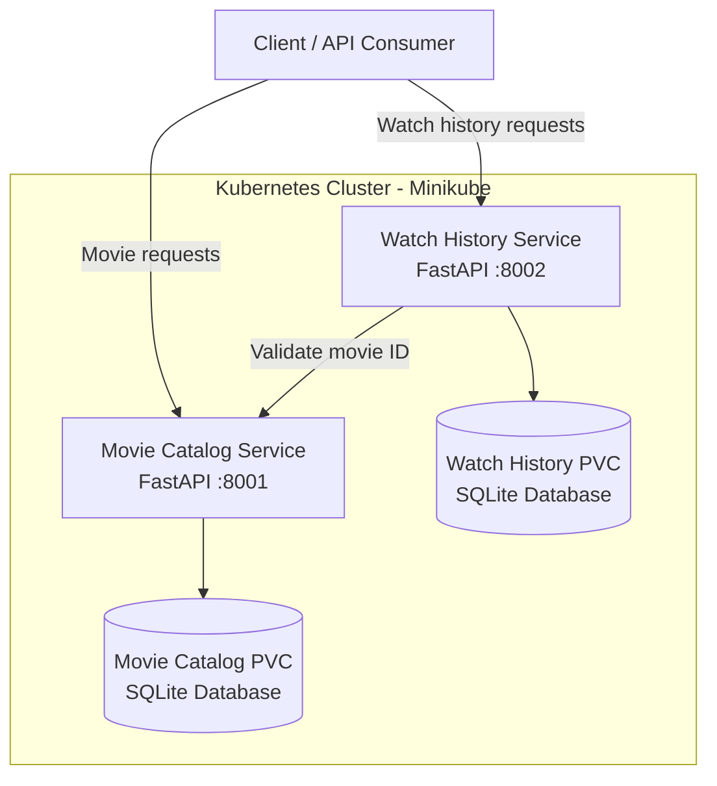

# Movie Streaming Management System

A cloud-native Movie Streaming Management System developed using Python, FastAPI, Docker, and Kubernetes.

The application follows a microservices architecture with independently deployable services for movie catalog management and user watch history. The project also demonstrates persistent storage, horizontal pod autoscaling, API testing, and automated CI/CD workflows using GitHub Actions.

## 1. Project Overview

The system consists of two microservices.

### Movie Catalog Service

Responsibilities:
- Add new movies.
- Retrieve all movies.
- Retrieve movie details using a movie ID.
- Provide a health-check endpoint.

### Watch History Service

Responsibilities:
- Record movies watched by users.
- Retrieve watch history for a specific user.
- Validate movie IDs through the Movie Catalog Service.
- Provide a health-check endpoint.

## 2. System Architecture



The services communicate through Kubernetes service discovery. Each service maintains its own database and can be deployed independently.

## 3. Technology Stack

| Technology | Purpose |
|---|---|
| Python | Application development |
| FastAPI | REST API framework |
| SQLite | Application database |
| Docker | Containerization |
| Kubernetes | Container orchestration |
| Minikube | Local Kubernetes cluster |
| kubectl | Kubernetes management |
| Git | Version control |
| GitHub | Source code hosting |
| GitHub Actions | CI/CD automation |
| pytest | Automated testing |
| Postman | API testing |
| HPA | Horizontal Pod Autoscaling |
| PersistentVolumeClaims | Persistent application storage |

## 4. GitHub Repositories

The project is maintained using three repositories:

- Main Project: https://github.com/SatyaBITS264/MovieStreamingSystem
- Movie Catalog Service: https://github.com/SatyaBITS264/movie-catalog-service
- Watch History Service: https://github.com/SatyaBITS264/watch-history-service

The main repository references both microservice repositories as Git submodules.

## 5. Project Structure

```text
MovieStreamingSystem/
|
|-- movie-catalog-service/
|-- watch-history-service/
|
|-- deployment/
|   |-- kubernetes/
|       |-- catalog-pvc.yaml
|       |-- history-pvc.yaml
|       |-- movie-catalog.yaml
|       |-- watch-history.yaml
|
|-- docs/
|   |-- architecture/
|   |   |-- architecture.md
|   |-- api/
|   |   |-- api-reference.md
|   |-- deployment/
|       |-- deployment-guide.md
|
|-- evidence/
|   |-- ci_cd/
|   |-- hpa/
|   |-- persistence/
|   |-- postman/
|
|-- .gitmodules
|-- README.md
```

Automated tests and GitHub Actions workflows are maintained inside their respective service repositories.

## 6. Deployment Environment

The application is deployed on a local Minikube Kubernetes cluster.

| Component | Configuration |
|---|---|
| Movie Catalog container port | 8001 |
| Watch History container port | 8002 |
| Movie Catalog NodePort | 30081 |
| Watch History NodePort | 30082 |
| Movie Catalog database | /data/movies.db |
| Watch History database | /data/history.db |

Both services use separate PersistentVolumeClaims to retain their SQLite database files.

## 7. Kubernetes Deployment

Detailed deployment instructions are available in:

`docs/deployment/deployment-guide.md`

General deployment workflow:

1. Start Docker Desktop.
2. Start the Minikube cluster.
3. Build both Docker images inside Minikube.
4. Apply the PersistentVolumeClaim manifests.
5. Apply the application Deployment and Service manifests.
6. Verify Pods, Services, and PVCs.
7. Access the APIs using Swagger UI.

From the project root, apply the manifests:

```powershell
kubectl apply -f .\deployment\kubernetes\catalog-pvc.yaml
kubectl apply -f .\deployment\kubernetes\history-pvc.yaml
kubectl apply -f .\deployment\kubernetes\movie-catalog.yaml
kubectl apply -f .\deployment\kubernetes\watch-history.yaml
```

## 8. API Documentation

FastAPI Swagger UI is available through Kubernetes port forwarding.

### Movie Catalog

```powershell
kubectl port-forward service/movie-catalog-service 8004:8001
```

URL: http://127.0.0.1:8004/docs

### Watch History

```powershell
kubectl port-forward service/watch-history-service 8003:8002
```

URL: http://127.0.0.1:8003/docs

Detailed endpoint information is available in `docs/api/api-reference.md`.

## 9. Inter-Service Communication

When a client submits a watch history record:

1. Watch History receives the user ID and movie ID.
2. It calls Movie Catalog to validate the movie ID.
3. Movie Catalog returns the movie details.
4. Watch History stores the record in its own SQLite database.
5. The API returns the saved record.

Kubernetes service URL:

`http://movie-catalog-service:8001`

The Watch History service returns appropriate errors when the requested movie does not exist or the Catalog service is unavailable.

## 10. Persistent Storage and Data Persistence

The application uses two independent SQLite databases:

- Movie Catalog: `/data/movies.db`
- Watch History: `/data/history.db`

PersistentVolumeClaims mount storage into the respective application containers.

Persistence was verified by:

1. Recording baseline movie and watch-history data.
2. Deleting the application Pods.
3. Allowing Kubernetes Deployments to recreate the Pods.
4. Querying the application APIs again.
5. Confirming that previously stored data remained available.

This demonstrates data persistence across application Pod replacement in the tested Minikube environment.

Evidence is available in:

`evidence/persistence/`

## 11. Horizontal Pod Autoscaling (HPA)

Horizontal Pod Autoscaling was configured for both microservices.

The HPA configuration uses:

| Parameter | Configuration |
|---|---|
| Movie Catalog minimum replicas | 1 |
| Movie Catalog maximum replicas | 5 |
| Watch History minimum replicas | 1 |
| Watch History maximum replicas | 5 |
| Target CPU utilization | 50% |
| Metrics provider | Kubernetes Metrics Server |

The Metrics Server was enabled in Minikube to provide CPU and memory metrics.

HPA was demonstrated by generating repeated API requests against both services and observing increased replica counts.

Useful commands:

```powershell
kubectl get hpa
kubectl top pods
kubectl get deployments
kubectl get pods
```

The load-generation demonstration and replica scaling screenshots are available in:

`evidence/hpa/`

Note: This is a local Minikube demonstration. Production deployment would require further capacity planning and database concurrency considerations.

## 12. CI/CD Using GitHub Actions

Automated CI/CD workflows were implemented independently for both microservices.

### Movie Catalog CI/CD

Repository:

https://github.com/SatyaBITS264/movie-catalog-service

Workflow: `Movie Catalog CI/CD`

Automated tests: 6

### Watch History CI/CD

Repository:

https://github.com/SatyaBITS264/watch-history-service

Workflow: `Watch History CI/CD`

Automated tests: 7

### Pipeline Activities

Both workflows are triggered by:

- Pushes to the main branch.
- Pull requests targeting the main branch.

Each workflow performs the following steps:

1. Checks out the source code.
2. Sets up Python 3.12.
3. Installs application and development dependencies.
4. Executes automated pytest test cases.
5. Sets up Docker Buildx.
6. Builds the corresponding Docker image.

Docker image tags used for CI build verification:

- `movie-catalog-service:ci-test`
- `watch-history-service:ci-test`

Both GitHub Actions workflows were executed successfully.

The current pipeline validates tests and Docker image builds. It does not publish images to a container registry or automatically deploy to Kubernetes.

Workflow execution evidence is available in:

`evidence/ci_cd/`

## 13. API Testing Using Postman

Postman was used to validate the REST APIs of both services.

The test coverage includes:

- Movie Catalog health check.
- Creating a movie.
- Retrieving all movies.
- Retrieving a movie by ID.
- Handling an invalid movie ID.
- Watch History health check.
- Creating and retrieving watch-history records.

The Postman screenshots are available in:

`evidence/postman/`

## 14. Project Documentation

| Document | Location |
|---|---|
| Architecture | `docs/architecture/architecture.md` |
| API Reference | `docs/api/api-reference.md` |
| Deployment Guide | `docs/deployment/deployment-guide.md` |

## 15. Project Evidence

The evidence directory contains screenshots demonstrating:

- CI/CD workflow execution.
- Automated test execution.
- HPA scaling under load.
- Kubernetes deployment and Pod state.
- PersistentVolumeClaims.
- Postman API testing.
- Data persistence after Pod replacement.

## 16. Limitations and Future Enhancements

Potential future improvements include:

- Authentication and authorization.
- API Gateway integration.
- Centralized logging and distributed tracing.
- Enhanced monitoring and alerting.
- Automated Docker image publishing.
- Automated Kubernetes deployment through a CD pipeline.
- Production-grade database storage and concurrent write handling.
- Movie recommendation functionality.

## 17. Conclusion

This project demonstrates the development and deployment of a microservices-based application using FastAPI, Docker, and Kubernetes.

It covers independent microservices, REST API communication, containerization, Kubernetes orchestration, persistent storage, horizontal pod autoscaling, API testing, and automated CI/CD workflows using GitHub Actions.

The project provides practical experience in building, testing, deploying, and monitoring cloud-native applications.
