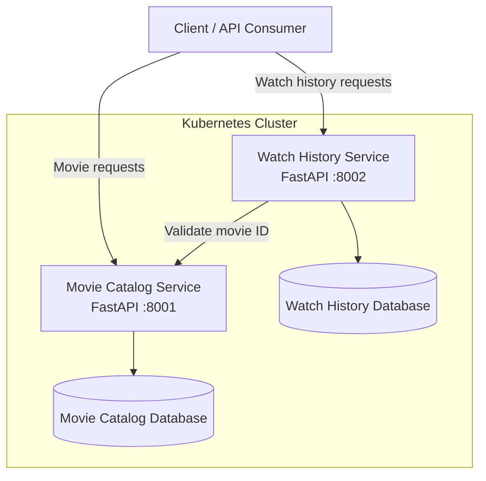

# Movie Streaming Management System

A cloud-native Movie Streaming Management System developed using Python, FastAPI, Docker, and Kubernetes.

The application follows a microservices architecture with independently deployable services for movie catalog management and user watch history.

## 1. Project Overview

The system consists of two microservices:

### Movie Catalog Service

Manages movie information.

Responsibilities:
- Add new movies.
- Retrieve all movies.
- Retrieve movie details using a movie ID.
- Provide a health-check endpoint.

### Watch History Service

Manages user watch history.

Responsibilities:
- Record movies watched by users.
- Retrieve watch history for a specific user.
- Validate movie IDs through the Movie Catalog Service.
- Provide a health-check endpoint.

## 2. Architecture

The services communicate through Kubernetes service discovery.
3. Technology Stack
TechnologyPurpose
PythonApplication development
FastAPIREST API framework
SQLitePersistent application databases
DockerContainerization
KubernetesContainer orchestration
MinikubeLocal Kubernetes cluster
kubectlKubernetes management
GitVersion control
GitHubSource code hosting

4. GitHub Repositories
The microservices are maintained in separate repositories.
- Main Project Repository
- Movie Catalog Service
- Watch History Service
The main repository references the two service repositories as Git submodules.
5. Project Structure
MovieStreamingSystem/
|
|-- movie-catalog-service/
|-- watch-history-service/
|
|-- deployment/
|   |-- kubernetes/
|       |-- catalog-pvc.yaml
|       |-- history-pvc.yaml
|       |-- movie-catalog.yaml
|       |-- watch-history.yaml
|
|-- docs/
|   |-- architecture/
|   |   |-- architecture.md
|   |-- api/
|   |   |-- api-reference.md
|   |-- deployment/
|       |-- deployment-guide.md
|
|-- evidence/
|   |-- kubernetes/
|   |-- api-testing/
|   |-- persistence/
|
|-- tests/
|
|-- .gitmodules
|-- README.md

6. Deployment Environment
The application is deployed on a local Minikube Kubernetes cluster.
ComponentConfiguration
Movie Catalog container port8001
Watch History container port8002
Movie Catalog NodePort30081
Watch History NodePort30082
Catalog database/data/movies.db
History database/data/history.db

Both services use separate PersistentVolumeClaims to retain their SQLite database files.
7. Deployment Instructions
Detailed deployment instructions are available in:

docs/deployment/deployment-guide.md

The general deployment workflow is:
1. Start Docker Desktop.
2. Start the Minikube cluster.
3. Build both Docker images inside Minikube.
4. Apply the PersistentVolumeClaim manifests.
5. Apply the application Deployment and Service manifests.
6. Verify pods, services, and PVCs.
7. Access the APIs using Swagger UI.
From the project root, the Kubernetes manifests can be applied using:
kubectl apply -f .\deployment\kubernetes\catalog-pvc.yaml
kubectl apply -f .\deployment\kubernetes\history-pvc.yaml
kubectl apply -f .\deployment\kubernetes\movie-catalog.yaml
kubectl apply -f .\deployment\kubernetes\watch-history.yaml

8. API Documentation
FastAPI Swagger UI is available through Kubernetes port forwarding.

Movie Catalog:
kubectl port-forward service/movie-catalog-service 8004:8001

URL: http://127.0.0.1:8004/docs

Watch History:
kubectl port-forward service/watch-history-service 8003:8002

URL: http://127.0.0.1:8003/docs

Detailed endpoint information is available in docs/api/api-reference.md.
9. Inter-Service Communication
When a client submits a watch history record:
1. Watch History receives the user ID and movie ID.
2. It calls Movie Catalog to validate the movie ID.
3. Movie Catalog returns the movie details.
4. Watch History stores the record in its own SQLite database.
5. The API returns the saved record.
Kubernetes service URL:

http://movie-catalog-service:8001
10. Persistence
The application uses two independent SQLite databases:
- Movie Catalog: /data/movies.db
- Watch History: /data/history.db
PersistentVolumeClaims mount storage into the respective application containers.

The persistence verification is documented in the project evidence directory.
11. Project Documentation
DocumentLocation
Architecturedocs/architecture/architecture.md
API Referencedocs/api/api-reference.md
Deployment Guidedocs/deployment/deployment-guide.md

12. Project Evidence
The evidence directory is intended to contain screenshots demonstrating:
- Kubernetes deployments and pods.
- Kubernetes services.
- PersistentVolumeClaims.
- API testing results.
- Database persistence after pod replacement.
13. Future Enhancements
Potential future enhancements include:
- Authentication and authorization.
- API Gateway.
- Centralized logging.
- Enhanced monitoring and alerting.
- Automated CI/CD pipelines.
- Horizontal Pod Autoscaling.
- Additional movie recommendation functionality.
14. Conclusion
This project demonstrates the development and deployment of a microservices-based application using FastAPI, Docker, and Kubernetes.

It covers independent services, REST API communication, containerization, Kubernetes orchestration, and persistent storage.
